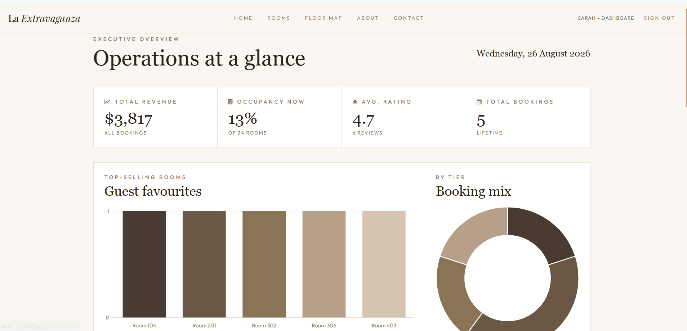
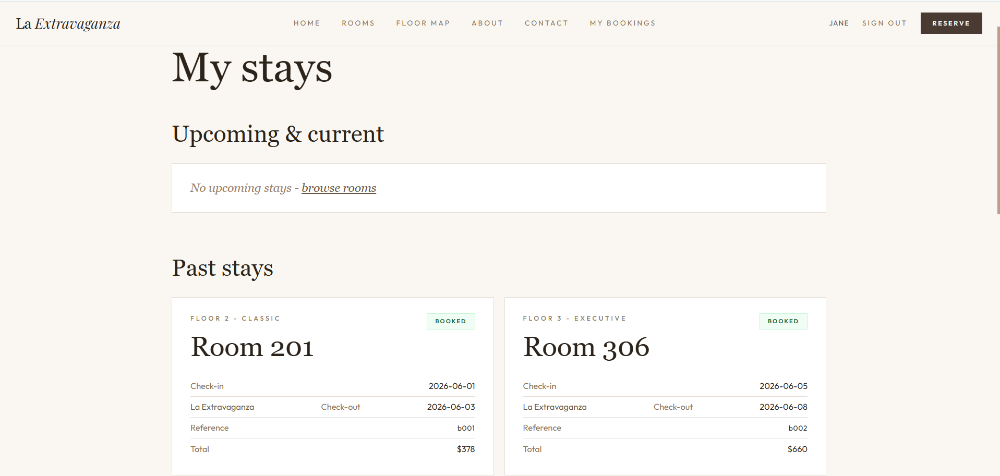

# La Extravaganza — Hotel Booking & Management System

A full-stack hotel booking platform built for a software engineering course, with three
distinct user roles — **customer**, **staff**, and **manager** — each backed by its own
authenticated views and API access. The project focuses on a clean layered backend
architecture, role-based access control, and a manager analytics dashboard driven by
live booking data.

## Highlights

- **Role-based system**: customers book rooms, staff manage check-ins and shifts,
  managers view revenue and occupancy analytics — each role is enforced server-side,
  not just hidden in the UI.
- **JWT authentication with hashed passwords**: `bcryptjs` hashes passwords on
  registration; login issues a signed JWT (8h expiry) carrying the user's id, name,
  and role, verified on every protected request via middleware.
- **Manager analytics dashboard**: four live Chart.js visualisations (top rooms bar
  chart, booking-mix doughnut, booking-trend line chart, revenue-by-floor bar chart),
  all driven by real booking/room/review data rather than static mockups.
- **Layered backend architecture**: routes → controllers → repositories, with
  Express middleware handling auth and role checks — separation of concerns rather
  than logic living directly in route handlers.
- **AI assistant with voice**: a chat widget on every page that can find and book
  rooms for guests, check guests in and out for staff, and summarise performance for
  the manager. It can only use tools allowed for the signed-in role, and every change
  waits for the user to click Confirm. It runs on a hosted AI model: free Groq or
  Google Gemini keys, or the paid Claude API - see [AI Assistant](#ai-assistant).
- **Date-based availability**: a room can be booked for any dates that don't overlap
  an existing stay; "occupied" means someone is in the room today.
- **75 automated tests** (Jest) covering auth, booking calculations, availability,
  payments, the AI assistant, and an end-to-end integration flow.

## Screenshots



## Tech Stack

- **Backend**: Node.js, Express 5, JWT (`jsonwebtoken`), `bcryptjs`
- **AI**: [Groq](https://groq.com) or [Google Gemini](https://ai.google.dev) (free tiers),
  or Claude via the Anthropic SDK (`@anthropic-ai/sdk`); browser Web Speech API for voice
- **Frontend**: Vanilla HTML/CSS/JS, [Chart.js](https://www.chartjs.org/) for the
  manager analytics dashboard
- **Data**: JSON files as a lightweight datastore (see [Data](#data) below)
- **Testing**: Jest (75 tests across auth, booking, availability, payment, AI, and integration)
- **Tooling**: ESLint, Nodemon

## Architecture

```
backend/
  routes/         → defines API endpoints, applies auth/role middleware
  controllers/     → request handling
  services/        → business logic shared by routes and the AI assistant
  repositories/    → reads/writes the JSON datastore
  ai/              → the AI assistant: config, tools per role, model providers
  middleware/      → JWT authentication and role-based access control
  data/            → JSON files acting as the dev datastore
frontend/
  pages/           → HTML pages (customer, staff, manager views)
  js/               → page logic, API calls, Chart.js dashboard rendering
  css/              → styling
tests/              → Jest unit and integration tests
```

Routes are kept thin — they wire up middleware and hand off to controllers, which
contain the actual logic and call into repositories for data access. This mirrors how
a real backend is structured before you swap the JSON datastore for a proper database.

## Getting Started

**Prerequisites**: Node.js 18+ and npm.

```bash
npm install
```

Set up the AI assistant (creates `.env`, asks for a free Groq or Gemini key and
checks it works):

```bash
npm run setup:ai
```

Run in development (auto-restarts on changes):

```bash
npm run dev
```

Or run as you would in production:

```bash
npm start
```

The backend serves the frontend statically — open `http://localhost:3000` after the
server starts.

## API Overview

| Method | Endpoint            | Access           | Description                       |
| ------ | -------------------- | ---------------- | ---------------------------------- |
| POST   | `/auth/register`     | Public           | Register a new customer account    |
| POST   | `/auth/login`         | Public           | Login, returns a JWT               |
| GET    | `/rooms`              | Public           | List rooms                         |
| GET    | `/rooms/:id`          | Public           | Room details                       |
| GET    | `/rooms/:id/availability` | Public       | Is a room free for given dates?    |
| POST   | `/bookings`           | Customer         | Create a booking                   |
| GET    | `/bookings`           | Authenticated    | List bookings                      |
| POST   | `/payment/process`    | Authenticated    | Payment endpoint (stub)            |
| GET    | `/shifts/mine`        | Staff/Manager    | Your shift schedule                |
| GET    | `/checkins/today`     | Staff/Manager    | Today's check-ins                  |
| GET    | `/checkins/queue`     | Staff/Manager    | Guests awaiting check-in           |
| POST   | `/checkins/checkin/:id`  | Staff/Manager | Check a guest in                   |
| POST   | `/checkins/checkout/:id` | Staff/Manager | Check a guest out, freeing the room|
| GET    | `/manager/stats`      | Manager only     | Revenue, occupancy, ratings summary|
| GET    | `/manager/top-rooms`  | Manager only     | Booking counts by room             |
| GET    | `/reviews`            | Public           | Public guest reviews               |
| GET    | `/ai/greeting`        | Authenticated    | Assistant's opening message        |
| POST   | `/ai/chat`            | Authenticated    | Send a message to the assistant    |
| POST   | `/ai/actions/:id/confirm` | Authenticated | Carry out a card the user confirmed |

Role checks (`staff`, `manager`) are enforced by middleware on the server, not just
hidden in the frontend — a customer token cannot access manager routes even by calling
the API directly.

## Data

**Demo data.** `npm run seed:demo` fills the hotel with about three months of realistic
history and a month of upcoming bookings (around 560 bookings with check-ins, reviews,
cancellations, no-shows and a staff rota). Existing accounts are kept; made-up guests use
`@example.com` addresses and the password `password`. The current files are backed up to
your temp folder first. `npm run check:stats` then recalculates every manager-dashboard
number straight from the data files and confirms the dashboard reports the same.

**Live dashboard.** The manager dashboard keeps a connection open to the server and
refreshes itself ("Live · updated …") whenever a booking, cancellation, check-in or
check-out happens, without reloading the page.


This project uses JSON files in `backend/data/` (rooms, bookings, users, shifts,
check-ins, reviews) as a lightweight datastore for development and testing, accessed
through a repository layer. This keeps the layer boundary in place, so swapping in a
real database (e.g. PostgreSQL or MongoDB) would mean changing the repositories only —
routes and controllers wouldn't need to change.

## Testing

```bash
npm test
```

75 Jest tests across nine suites: authentication, booking logic, date-based
availability and check-in/out, payment handling, the AI assistant, and an end-to-end
integration flow. Tests run against a temporary copy of `backend/data/`, so they never
change the real data files. The AI tests use a scripted fake model, so they need no API
key and cost nothing.

## AI Assistant

A round chat button sits in the bottom-right corner of every page (except sign-in and
registration). What the assistant can do depends on who is signed in:

| Role | Can do |
| ---- | ------ |
| Customer | Search rooms by dates, price and guests; explain rooms; show their bookings; propose a booking, then send them to the payment form |
| Staff | See who's arriving and who's in residence; check room availability; check guests in and out |
| Manager | Read-only: summarise revenue, occupancy, trends, floors, staff and reviews in any form asked |

**Safety.** The server picks the assistant's tools from the role in the login token,
so a customer can never reach staff or manager tools. Tools never change data
themselves: they show a card, and the change happens only when the user clicks
Confirm.

**Voice.** Press the microphone to speak a message, and the speaker icon to have
replies read aloud. This uses the browser's built-in speech features (Chrome, Edge,
Safari). In other browsers the buttons are hidden.

**Customising it.** Everything about the assistant's behaviour lives in
[`backend/ai/assistant.config.js`](backend/ai/assistant.config.js): its name,
personality, the hotel facts it can share, each role's greeting, suggestions and
instructions, and safety limits. Tools are in `backend/ai/tools/`, one file per role.

**Choosing the model.** Aria runs on a hosted model, so nothing extra is installed
on your computer. Run `npm run setup:ai` to pick one, or set a key in `.env` yourself:

| Provider | Cost | Get a key | Notes |
| -------- | ---- | --------- | ----- |
| Groq | Free tier | [console.groq.com/keys](https://console.groq.com/keys) | Very fast; free tier has per-minute limits |
| Google Gemini | Free tier | [aistudio.google.com/apikey](https://aistudio.google.com/apikey) | On the free tier Google may use chats to improve its products |
| Claude | Paid per message | [console.anthropic.com](https://console.anthropic.com) | Most capable with tools |

With `AI_PROVIDER=auto` (the default) Aria uses whichever keys are set. When one service hits
its free limit, Aria quietly switches to the next and switches back once the limit resets, so
setting both a Groq and a Gemini key roughly combines their free allowances. If every
service is at its limit, the chat says Aria needs a short break and pauses until one is back.
`npm run setup:ai` offers to add the second free key as a backup. Every teammate creates their own free key. **Never commit a
key** - keys live only in `.env`, which git ignores. Without a key, the chat window shows how
to set one up.

Conversations are kept
in server memory and reset when the server restarts.

## Security Notes

This was built as a coursework project, so a couple of things are worth flagging
rather than hiding:

- The JWT secret is read from `process.env.JWT_SECRET` (see `.env.example`) rather
  than hardcoded, so it isn't committed to version control.
- Passwords are hashed with `bcryptjs` before storage — plaintext passwords are never
  written to disk.
- The JSON-file datastore is fine for development but isn't safe for concurrent
  writes at production scale — a real deployment would move this to a proper database.

## License

ISC (see `package.json`).
